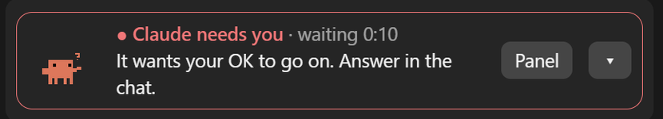
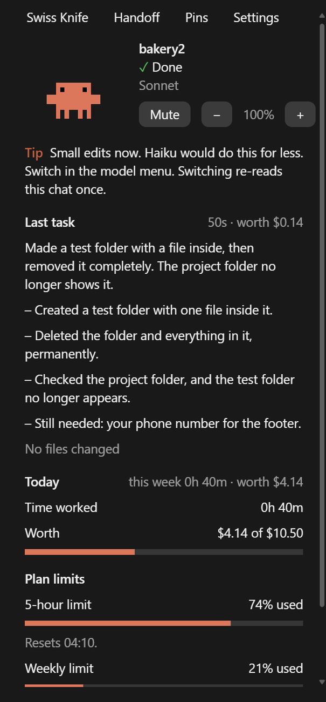

# 🔪 Swiss Knife for Claude Code

**A free Claude Code mod that fixes the 3 most annoying things about Claude Code. One-line install, no coding.**

[](LICENSE)


<p align="center">
  <br>
  
</p>

---

## The 3 fixes

### 1. Claude waits for you, and you don't notice
You leave Claude working, come back an hour later, and find it has been waiting 40 minutes for you to click **Allow**.
Swiss Knife plays a **chime**, sends a **desktop notification** and turns the strip **red** the moment Claude needs you. Still waiting after 5 minutes? It pings you again.

### 2. You hit your plan limit by surprise
Your 5-hour and weekly limits appear as gauges with reset times and a **forecast**: *"At this pace your 5-hour limit runs out around 15:10."* You get a heads-up at 80% and again at 95%.

### 3. The chat gets long, slow and forgetful
When the chat is about 70% full, Swiss Knife suggests a fresh start. Click **Continue in a new chat**: it writes a short handoff note (the goal, where things stand, files, decisions, the next step). Open a new chat in the same project and Claude reads it with your first message. Nothing is lost, and you never have to type `/clear`.

---

## Install (1 minute)

You need [Claude Code](https://docs.claude.com/en/docs/claude-code) **2.1.287 or newer** (run `claude update`).

> Mods install through Claude Code's plugin system, so the command says `plugin`. A mod is a plugin that changes Claude Code itself: its screen, sounds and prompts.

**In a terminal Claude Code session**, paste:

```
/plugin install swiss-knife --marketplace nocodehack/swiss-knife
```

Answer `y` to add the marketplace, then press **Enter** to install it for your user. That's it: the strip and the panel show up right away.

<details>
<summary>Other ways to install</summary>

**From a shell (PowerShell, Terminal):**

```
claude plugin install swiss-knife --marketplace nocodehack/swiss-knife
```

**In the Claude desktop app:** click **+** next to the prompt box → **Plugins** → **Add marketplace** → type `nocodehack/swiss-knife` → **Add plugin**.

A mod installed from a terminal also loads in the desktop app's local sessions.
</details>

---

## Everything in the box

Each feature can be turned on or off in the **Settings** tab.

| | What it does |
|---|---|
| 🔔 **Needs you** | Chime, notification and a red strip when Claude asks a question, wants permission or wants a plan approved. |
| 📊 **Plan limits** | 5-hour and weekly gauges, reset times, and a "runs out around…" forecast. |
| 🧳 **Handoff** | A handoff note for a new chat when this one gets full. **More details** writes the long version. Kept in `.claude/handoffs/`. |
| ⏱ **Time & cost** | Working time and cost per project (breaks don't count). On a subscription it shows what the work is *worth* at API prices, not a bill. |
| 💸 **Budget** | A daily budget per project, with warnings at 80% and 100%. |
| 🛡 **Guard** | Commands that destroy work (`rm -rf`, `git reset --hard`, force-push, `curl … \| bash`) stop at Claude Code's own permission prompt with a plain-English question. |
| ✅ **Last task** | After each task: what got done, step by step, what is still needed, and the files changed. |
| 🧭 **Model tips** | Says when a cheaper or stronger model fits the work better. You switch in the model menu. |
| ⏳ **Quick memory timer** | Warns before Claude's cache of a big chat (50k+ tokens) runs out, using your `promptCacheTtl` setting. |
| 📌 **Pins** | Pin any reply. Plans you approve are pinned for you. |
| 🙈 **Hide secrets** | Keys, passwords and emails show as a grey bar on screen, handy when you record or share your screen. Claude still gets the real text. |
| 🦀 **Mascot** | A pixel buddy that shows what Claude is doing: thinking, writing, testing, done, or asleep on your break. |
| 📝 **/report** | 1–3 plain-English lines of what you did today or this week, with time and cost. Ready to send to a client. |

**See any feature in seconds:** Settings → **Try a feature**, or type `/knife demo cache`, `handoff`, `limits`, `needs-you`, `budget` or `recap`.

---

## Commands

| Command | What it does |
|---|---|
| `/handoff` | Write a handoff note now (`/handoff <next step>` adds your own next step) |
| `/report` · `/report week` | Plain-English summary of today or the last 7 days |
| `/pin` · `/pin <text>` · `/pin off` | Pin the last reply, pin your own note, or remove all pins |
| `/budget 5` · `/budget 20%` · `/budget off` | Daily dollars, or a share of your weekly limit, for this project |
| `/knife` | Status. Also `on`, `off`, `show`, `sound on/off`, `volume 0-100`, `handoff <percent>`, `demo <name>` |

You never *need* a command: everything is a button in the panel.

---

## Safety and privacy

- **Guard is a seatbelt, not a vault.** It catches the common destructive commands and asks you first. It never approves anything by itself, and it can't catch every way to delete a file.
- **Your numbers stay on your computer**, in Claude Code's own storage for this mod.
- **Four features send text to Claude**, using your own Claude Code login. No API key is needed, and each call costs a fraction of a cent:
  - the handoff note (your chat; Haiku, or Sonnet for More details)
  - the last-task recap after longer tasks (your request and Claude's reply)
  - `/report` (what you asked and Claude's replies)
  - model tips (the last few messages)

  The handoff and `/report` run only when you ask. Model tips can be turned off in Settings.

---

## If something breaks

Claude Code mods are new and Claude Code updates often. If an update breaks something:

- **Turn it off:** Settings → **Turn Swiss Knife off**, or type `/knife off`.
- **Uninstall:** `/plugin uninstall swiss-knife` in a terminal session (or `claude plugin uninstall swiss-knife`).
- **Tell me:** open an [issue](https://github.com/nocodehack/swiss-knife/issues) with what you saw.

---

## Related

Want to go deeper on the cache? [**cache-tax**](https://github.com/karanb192/cache-tax) by Karan Bansal keeps the cache warm during breaks and shows the exact price of a cold resend.

---

<sub>Unofficial. Not made by or affiliated with Anthropic. Claude and Claude Code are trademarks of Anthropic.<br>
Made by [@nocodehack](https://www.youtube.com/@nocodehack) · MIT License</sub>
